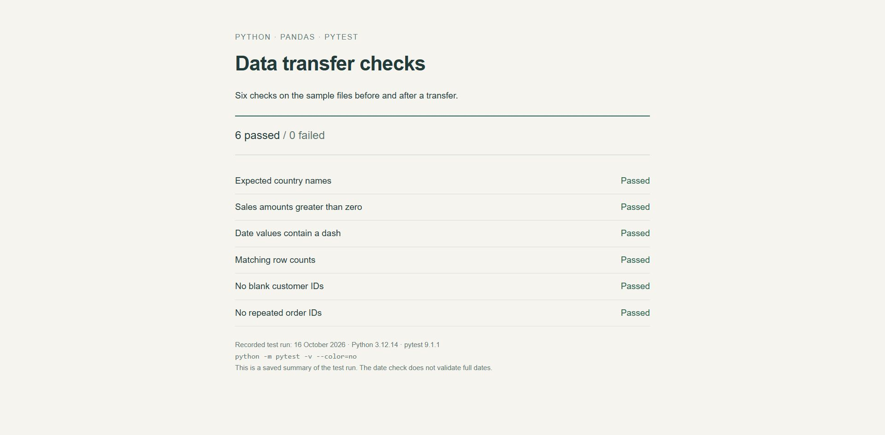

# Data transfer checks

A small Python project that checks two CSV files before and after a data transfer.

Moving a file is only part of the job. These checks help spot missing records, blank customer IDs and repeated order numbers before the new file is used for reporting.



## What is checked

- Both files contain the same number of rows.
- Customer IDs in the new file are not blank.
- Order IDs in the new file are not repeated.
- Country names are from the expected list.
- Sales amounts are greater than zero.
- Date values contain a dash.

## Run the checks

Install Python, then run these commands from this repository folder:

```bash
python -m pip install -r requirements.txt
python -m pytest -v
```

The `data/` folder contains the two sample CSV files. The `tests/` folder contains the six checks.

## What these checks do not prove

A passing result does not mean every value transferred correctly. The date check only looks for a dash; it does not confirm a valid date. The tests do not yet compare every source row with its matching target row or verify all rounding and name changes.

[Transfer rules](docs/migration-rules.md) describe the intended changes. [Test notes](docs/test-report.md) separate the checks that run from the improvements still needed.
